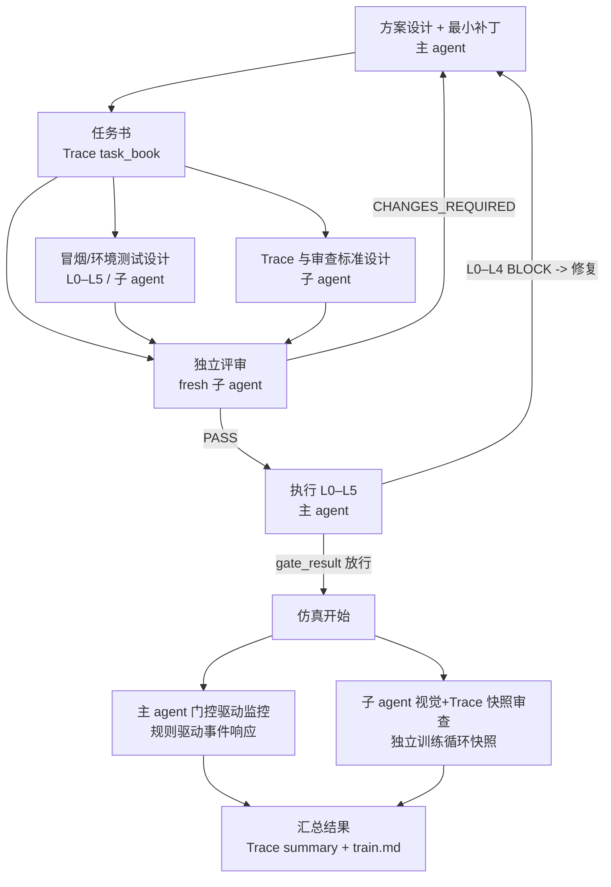

# robotdog-train：训练实验门禁

> 本 skill 规定**工作方式**，不重复项目说明。规则真值仍是 `agent.md`：
> §1 文档同步义务、§2 先查 experience.md、§5 验证流程、§7 文档规范、§8 视觉评审。
> 视觉 rubric 与抽帧细节在 skill `visual-monitor`，本 skill 只定触发、交叉验证与落账。

> **展示规则（强制）**：面向用户的摘要一律用中文全名，代号只放在括号里；训练配置写“用途 + 路径”，
> 不写裸 `level0`/`L3`/`go_with_risk`。启动前必须先展示任务书、L0–L5 测试设计、Trace 设计摘要；
> 自动开始也先展示，展示后直接启动，不强制人工确认。模板与术语表见 `references/presentation.md`。

## 0. 适用边界

**走完整门禁**（训练影响型改动）：

- `robotdog/**`、`scripts/train.py`、`scripts/play.py`、`config.yaml`、`ablations/*.yaml`；
- 奖励、课程、终止、观测、动作、步态先验、warm-start、评测链路；
- 任何改变训练分布、回报形状、成功判据或回放口径的默认值。

**不走双代理**（但仍守 §1/§7）：

- 只改 `doc/**`、`README.md`、`experience.md`、`train.md`、`.dsh/skills/**`；
- 纯排版、注释、日志文案，且不改变任何默认值/分支。

用户明确说“只改文档/只跑回放”时按用户范围降级，并在最终回复列出跳过的门禁。
**不得**因为“改动很小”跳过一个训练影响型改动的补齐、独立评审与 L0–L5。

## 1. 流程总览与角色



| 角色 | 做 | 不做 |
| --- | --- | --- |
| 主代理（你） | 方案/补丁、任务书、执行 L0–L5、放行决定、训练监控、事件响应、汇总 | 不把子代理猜测当结论；不自己改 E 的评审结论 |
| 测试设计子代理（C） | 设计 L0–L5 检查、命令、判据、证据指针 | 不执行测试、不写文件、不训练 |
| Trace 与审查标准设计子代理（D） | 设计 agent/rollout/summary 三层 Trace、事件、gate_result 与审查标准 | 不执行测试、不写文件、不训练 |
| 独立评审子代理（E） | 对任务书+测试设计+Trace/标准+真实 diff 做 fresh 独立评审，返回具体阻塞 | 不写文件、不跑训练/回放、不替主代理修 |
| 视觉与 Trace 快照审查子代理（H） | 对视觉帧与 Trace 快照做独立交叉验证 | 不单独下“成功”结论、不写文件、不碰训练 |

**隔离与清理门禁**：

- E、H 都必须 **fresh context**；不得复用上一任务/上一轮的 reviewer、monitor 或 subagent 会话。
- 同一任务内，C/D 只设计一次；任务书/测试设计/Trace 标准发生实质变化才重派。
- **新任务开始时先清点并清理多余子 agent**：查看 `list_agents` / `agent_teams_status`；
  归档/移除本任务不需要的 member；不复用旧 subagent ID；只保留本任务需要的 C/D/E/H。
  团队模式下删除/归档旧团队；普通 subagent 模式下启动新会话，不续旧上下文。
- 主代理是唯一写者；任何子代理写文件都视为违约。
- 所有结论必须能回到文件、命令输出或 Trace 证据；没有证据就标 `SUSPECT` 或 `INSUFFICIENT`。

## 2. 阶段 A：方案设计与最小补丁（主代理）

1. 先读 `agent.md` §2，按模块读 `doc/<module>.md` 的踩坑指引，再读
   `experience.md` 相关小节。
2. 形成方案：目标、影响文件+符号、行为 before/after、默认值/配置单源、eq_check 预期、
   文档同步、风险与回滚。方案只写事实和可验证声明。
3. **只落最小补丁**；不跑验证、不启动训练、不顺手改无关默认值。
4. 建立 scratch Trace：`.tmp/trace/<slug>.jsonl`，先追加 `agent_event: design`
   （commit、工作区、diff 路径、方案摘要）。不要另建独立任务书文档。
5. 生成限定路径 diff，供 C/D/E 读取：

```powershell
git status --short
git diff -- <改动路径> > .tmp/change_<slug>.diff
```

新增文件用 `git diff --no-index -- NUL <file>` 追加，或直接把路径交给评审。
当前工作区可能已有 `README.md`、`agent.md` 的改动和 `scripts/frames.py` 等
untracked 文件，**diff 必须限定路径**。

## 3. 阶段 B：任务书（Trace 字段，不写独立文档）

任务书是实验意图的压缩表示，写入 Trace 的 `task_book` 事件；C/D/E 都读它。
按实验类型分档，目标是一屏内可人工检视：

| 类型 | 什么时候用 | 必填核心 |
| --- | --- | --- |
| 确认性 confirmatory | 已有明确 claim，要验证/否证 | `claim` + `prediction`（方向/幅度）+ `threshold`（预先登记） |
| 探索性 exploratory | 机制/方向不确定，先探索 | `uncertainty` + 可证伪的 `prediction` + `stop_condition` |

公共字段：`experiment_id`、`experiment_type`、`change_scope`、`baseline`、
`key_changes`（每条带对照/指标）、`metrics`、`non_goals`、`human_summary`（≤5 行）。
不确定类型时按**探索性**写，并明确不确定性，不要硬编一个阈值。

- 任务书作为 `task_book` 事件写入 `.tmp/trace/<slug>.jsonl`；修改时追加
  `task_book_revision`，不覆盖旧版本。
- 不写 `.tmp/change_<slug>.md` 作为任务书；diff 文件和 Trace 事件才是评审输入。
- 详细模板与 JSON 例子见 `references/task-book.md`。

## 4. 阶段 C/D：并行设计（fresh 子代理，只读）

B 落定后，在**同一条消息**里并发派 C、D 两个 `fresh` 后台 `subagent`；两者互不可见。

| 子代理 | 提示词 | 输入 | 输出 |
| --- | --- | --- | --- |
| C 测试设计（冒烟/环境测试） | `references/test-design.md` | task_book、diff、改动路径、agent.md §5、experience、scripts、config | L0–L5 设计表、命令、判据、L5 审查触发、风险 |
| D Trace 与审查标准设计 | `references/trace-design.md` | task_book、diff、`references/review-standards.md` | 三层 Trace schema、事件类型、gate_result、快照审查字段 |

- 两者只设计，不执行；不写文件、不训练/回放/渲染。
- 主代理把输出合并成 `test_design` / `trace_design` 事件写入 Trace，不盲抄。
- C 必须给出每条检查的**证据指针**（文件::符号、命令、输出字段、产物路径），不能只写“检查一下”。
- D 必须让 Trace 可重建：agent 事件层、rollout 层、summary 层；gate_result 必须能承载
  L0–L5 的 PASS/BLOCK/SUSPECT 与证据指针。
- 超时/空输出：同 prompt 重试 1 次；仍失败→主代理补设计，标 `设计降级`，先问用户，
  不得省略 C/D 直接训练。

## 5. 阶段 E：独立评审（fresh，返回具体阻塞）

C/D 完成、主代理合并后，派一个 **fresh** E 子代理，提示词取自 `references/reviewer.md`。
E 的评审对象是**设计包 + 真实 diff**：

- B 任务书：类型是否正确、claim/prediction/threshold 或 uncertainty/stop 是否可检验；
- C 测试设计：L0–L5 是否覆盖、命令是否可执行、判据是否可观测、L5 失败是否只触发审查；
- D Trace 设计：三层是否齐全、gate_result/snapshot 字段是否够用、证据指针是否可追溯；
- 审查标准：通用/任务族/任务实例三层是否落到本任务；视觉纪律是否写清；
- 真实 diff、默认值单源、文档同步、warm-start/评测口径、经验死路。

输出必须含 `VERDICT: PASS | CHANGES_REQUIRED` 与每条 blocker 的
`id / location / severity / problem / evidence / required_fix`。

- blocker 修完重派 E 第 2 轮（只看新 diff 与上一轮 blocker）；最多 2 轮。
- 第 2 轮仍 `CHANGES_REQUIRED` 就停止报告用户，**不得带 blocker 进入 L0–L5 或训练**。
- 只改措辞可复用 E 结论；改任务书/测试设计/Trace 标准/行为则重派。
- E 不写文件、不跑测试/训练、不替主代理改代码。

## 6. 阶段 L0–L5：冒烟/环境测试与 gate_result（主代理执行）

E PASS 后，主代理按 C 的设计执行 L0–L5，并把结果写成 `gate_result` 事件。

| 级别 | 检查 | 典型动作 | 失败处理 |
| --- | --- | --- | --- |
| L0 导入与注册 | 模块可导入、环境/配置可注册 | `compileall` + import smoke；必要时环境 ID | `BLOCK` |
| L1 接口契约 | obs/action 维度与顺序、config/CLI、checkpoint 兼容 | 相关 `tests/test_*.py` + 契约探针/固定输入 | `BLOCK` |
| L2 物理与 MDP | 奖励项、终止、地形/踏面、固定种子、NaN | `eq_check.py` 三场景逐项 `reward_terms` | `BLOCK` |
| L3 最小训练循环 | 2000 步冒烟、课程标记、checkpoint | `.tmp/smoke.yaml` + `train.py` | `BLOCK` |
| L4 评估策略闭环 | eval 成功/摔倒、视频、路径 | `play.py --run <run> --mode eval --stage ... --sampled-command`，episodes ≥40 | `BLOCK` |
| L5 目标语义 | 极短训练后成功率是否朝任务书预测方向移动 | 与 task_book 的 prediction/threshold 对照 | `SUSPECT`，不阻断 |

- 状态只能是 `PASS` / `BLOCK` / `SUSPECT`；每行带 `evidence` 指针。
- **L0–L4 有 BLOCK**：修复后重跑该级；若任务书/测试设计/Trace 标准实质变化，重派 E。
- **L5 失败不阻断正式训练**：标 `SUSPECT`，另派一次 fresh **L5 风险审查**
  （独立子代理，输入任务书 + L5 证据 + Trace；输出是否放行、风险、需要的监控/停止条件）。
  主代理记录 `l5_review` 后才能选择 `go_with_risk`。
- 文档过期、默认值无单源、reviewer blocker 未清：一律 `fix_first`，不得放行。
- 写 `gate_result`：`levels` 数组（L0–L5，status + evidence）、
  `l5_review_required`、`release_decision: go | go_with_risk | fix_first`。

```json
{
  "layer": "agent",
  "event": "gate_result",
  "levels": [
    {"level": "L0", "status": "PASS", "evidence": "compileall:0; import:ok"},
    {"level": "L1", "status": "PASS", "evidence": "tests: env_contract/asymmetric/ablation all pass"},
    {"level": "L2", "status": "PASS", "evidence": ".tmp/eq_new.json: all terms identical"},
    {"level": "L3", "status": "PASS", "evidence": ".tmp/smoke.log: stage markers = config 级数"},
    {"level": "L4", "status": "PASS", "evidence": "eval: 100 episodes; video path"},
    {"level": "L5", "status": "SUSPECT", "evidence": "success delta -2pp; review required"}
  ],
  "l5_review_required": true,
  "release_decision": "go_with_risk"
}
```

`agent.md` §5 的 `py_compile robotdog/*.py ...` 在 PowerShell 下通配符不一定展开，
用 `compileall` 等价替代。冒烟也要记 `train.md`，标 `[冒烟]`。

### 6.1 启动前展示（强制，简约）

`gate_result` 写好后、`train.py` 启动前，先给用户看一屏摘要；自动开始也先展示，展示后直接启动，
不等待人工确认。模板、术语表与配置别名见 `references/presentation.md`。

必须包含三块，总长 ≤ 25 行：

1. **任务书摘要**（3–6 行）：实验名/类型、claim 或 uncertainty、prediction、threshold 或 stop、baseline、metrics。
2. **L0–L5 测试设计摘要**（6 行）：每级一行——中文名（`Lx`）→ 检查内容 → 命令/判据 → 当前状态（通过/阻断/存疑）。
3. **Trace 设计摘要**（3–5 行）：三层各一行；`gate_result` 字段；快照审查的指定问题与文件位置。

- 展示用中文全名，代号只放在括号里；禁止只写 `L3`、`E`、`go_with_risk`。
- 配置写“用途 + 路径”，如 `消融 level1（加 privileged foot contact，ablations/level1.yaml）`，不写裸 `level1`。
- `fix_first` 只展示阻断项，不启动；`go`/`go_with_risk` 展示后可直接启动。
- 若用户没有要求停下确认，**不要**问“是否开始”；在摘要末尾写“已自动开始训练，run=...”。
- `go_with_risk` 必须同时展示 L5 风险、监控项、停止条件。

## 7. 阶段 F：仿真开始

放行条件：`gate_result.release_decision` 为 `go` 或 `go_with_risk`；
L0–L4 无 `BLOCK`；L5 若 `SUSPECT` 已有独立风险审查记录。
满足条件并已展示启动前摘要即可启动；人工确认不是必需。只有用户明确要求“先给我看/等我确认”时才等待。

1. 选唯一 run 名（`train.py` 拒绝已存在目录）；不删旧 run 腾位置。
2. 建立 `runs/<run>/trace.jsonl`；把 `task_book`、`gate_result` 作为引用或事件带入；
   追加 `train_start`（commit、config、warm-start/norm、命令、job_id）。
3. 在 `train.md` 建条目骨架（结果待填）。
4. 受管后台启动，设 `PYTHONUNBUFFERED=1`：

```powershell
$env:PYTHONUNBUFFERED = "1"
.venv\Scripts\python.exe scripts\train.py --run-name <name> [--config <cfg>] [--warm-start <zip>] [--warm-norm auto|on|off]
```

## 8. 阶段 G：主代理门控驱动监控（规则驱动事件响应）

主代理持有训练 job 与事件响应权；H 只做快照审查，不控制训练。每 10–15 分钟或收到完成通知时
读一次输出，不忙轮询。事件规则：

| 事件 | 触发 | 主代理响应 | Trace |
| --- | --- | --- | --- |
| stage_end | `[课程] <<<` | 解析成功率/摔倒率/均回报/用时；对照任务书红线 | `rollout` 或 `stage_end` |
| nan/traceback/OOM | 日志/异常 | 暂停判断、保留最后 checkpoint、H 快照、记录中止 | `alert` + `abort` |
| success_low | ≥50% 步数预算后成功率 <10% 且摔倒率 >60% | 告警/暂停；先查证据，不盲目加步数 | `alert` |
| sps_drop | SPS 相对首级基线下降 >20% | 推迟中途渲染，训练后补 | `alert` |
| checkpoint_ready | 阶段末 | 中途渲染 ≤2 阶段（语义变化 + 最后完成） | `render` |
| l5_suspect | 放行后早期目标未移动 | 记录、触发独立审查；不静默继续 | `alert` |
| user_stop | 用户要求 | 保留 checkpoint、渲染+快照、记 [中止] | `abort` |

- 不要自动杀进程；先保留证据、判断是否可恢复。
- 中途渲染必须从 checkpoint zip 出发并显式 `--videos-dir runs/<run>/videos`；
  命令与配置见 `references/training-monitor.md`。
- 所有事件追加到 `runs/<run>/trace.jsonl`；不要只靠记忆或聊天记录。

## 9. 阶段 H：视觉 + Trace 快照审查（fresh 子代理）

触发：最终阶段必做；语义变化阶段必做；G 的异常/红线事件；用户要求。中途默认 ≤2 阶段。

- 用 `references/snapshot-review.md` 的完整提示词，派 **fresh** H 子代理；它只读，
  不写文件、不看代码改结论、不碰训练。
- 先加载 skill `visual-monitor` 执行视觉 rubric；H 负责把视觉与 Trace 交叉验证。
- H **不得单独给出“成功”**；必须回答：
  **“画面中的行为是否与任务书声明的成功定义一致？如果不一致，Trace 中哪一段证据支持这一判断？”**
- 输出至少包含 `VISUAL_TRACE_VERDICT: CONSISTENT | CONFLICT | INSUFFICIENT`、
  观察、Trace 证据指针、冲突/疑点、建议；证据不足就写 `INSUFFICIENT`，不要猜。
- 结果写 `snapshot_review` 事件进 Trace；主代理定根因，冲突时不得忽略视觉或数值任一方。
- 两臂比较各派独立 H；不复用同一 H 的上下文。

## 10. 阶段 I：汇总结果

- Trace 汇总层：`runs/<run>/trace_summary.json`（机器可读）+ 人可读的
  `runs/<run>/trace_report.md`（从 Trace 生成，不另写一套叙事）。
- `train.md` 固定字段：改动 / 结果 / 解读 / 产物与 GIF / 去向；补 run、命令、commit、
  config、分级表、eval、视觉结论、中止原因。
- **结果报告三件套（强制）**：① 训练成本（每级/总 wall time、总步数、平均 SPS、并发臂数）；
  ② 成功率（训练滑窗 + ≥40 回合 `--sampled-command` 回放，标明 stage/episodes；
  单 run 只能报 n=1，能力带结论要 3 seeds）；③ 预登记的每个 `key_changes` 的量化影响
  与对照口径；无法隔离时写明混淆项。
- 同步 `doc/<module>.md`、`README.md` 表、`experience.md`；没有新知识不硬写。
- 产物确认在 `runs/<run>/videos/` 与 Trace 目录，不在 `output/videos`。

## 11. 审查标准的三层与视觉纪律

审查标准随任务变化，分三层；详细表见 `references/review-standards.md`：

1. **通用层**（所有具身 RL）：NaN/Inf、维度与顺序、回合长度、奖励非退化、动作边界、
   终止条件、种子、config/commit、checkpoint 兼容、Trace 完整性、资源上限。
2. **任务族层**（按 MDP 类型）：本仓库是运动控制——基座高度/接触/步态相位/指令跟踪/踏面/摔倒；
   操作、导航等任务族在对应文档中补；视觉与 Trace 必须交叉一致。
3. **任务实例层**：任务书的 claim/prediction/threshold 或 uncertainty/stop_condition；
   没有实例标准的“成功”不算成功。

**视觉特殊纪律**：

- 视觉子代理不单独下“成功”结论；必须与 Trace 的回合结果、指标、任务书定义交叉验证。
- 视觉输出至少回答上面 §9 的可操作问题；不一致时必须给出 Trace 证据指针。
- 数值好但视觉冲突、或视觉好但 Trace 冲突：都标 `CONFLICT`，主代理定根因。

## 12. 失败模式

| 场景 | 动作 |
| --- | --- |
| C/D/E/H 超时或空输出 | 同 prompt 重试 1 次；仍失败→主代理补设计/自检，标“降级”，先问用户 |
| E 两轮仍 CHANGES_REQUIRED | 停止，报告 blocker；不带病进入 L0–L5/训练 |
| L0–L4 BLOCK | 修复后重跑；任务书/设计变更则重派 E；不得“先训了再看” |
| L5 SUSPECT | 不阻断；另派 fresh L5 风险审查；记录 go_with_risk 与停止条件 |
| eq_check 未解释差异 | 停止；定位 term；修完重跑 |
| 冒烟 OOM/MJCF 假错 | 先降并发/环境数；4 臂 OOM 会伪装成编译失败 |
| 训练崩溃/中止 | 读完整 job 输出；最后 checkpoint 渲染+H；记 [中止]；不静默重跑 |
| 某级成功率 0%/摔倒率极高 | 对照任务书红线；H 交叉验证；必要时停 |
| SPS 下降 >20% | 推迟中途渲染，结束后补 |
| 视频 <25 fps | 用 review config 重渲；不得喂 mp4 |
| 视觉/数值冲突 | 标 CONFLICT；主代理定根因；写入解读/经验 |
| 文档过期 | fix_first，先同步 |
| 新任务仍有旧 subagent | 清理/归档多余角色；不复用旧上下文 |
| 上下文压缩/断线 | 从 `runs/<run>/trace.jsonl`、checkpoint、train.md 恢复 |

## 13. 与 AgentTeams 的关系

默认**不用**：单变更/单臂用 `subagent` 更快，且 E/H 需要 fresh 隔离。
只有用户明确要求“用 AgentTeams”，或一次 campaign 有 ≥2 个改动/≥2 个训练臂时，
才按 `references/agent-teams.md` 启用。

- 用户已授权训练且不要求先看团队计划：用 `approval="automatic"`，展示训练前摘要后启动；
- 用户要求先看计划/等确认：用 `approval="required"`，等 Web Approve & Run；
- 任何情况下**不得自己 approve** staged plan。

团队模式下 E/H 仍优先由 captain 派 fresh `subagent`；新任务开始先清理/归档旧团队与多余 member。

## 14. 预算与完成判据

- E 评审 ≤2 轮；中途视觉 ≤2 阶段；每集 ≤6 张图；C 的 L0–L5 设计 ≤1 屏表。
- 完成判据：E PASS + L0–L4 PASS + L5 已记录（SUSPECT 时有独立审查）+ release_decision +
  训练/评估完成 + Trace summary + `train.md` + 视觉结论 + 文档同步 + 结果三件套。
- 本 skill 只规定流程；训练必须由用户任务明确授权。授权后，满足放行条件并展示启动前摘要即可自动开始，
  不要求逐步人工确认；纯代码修改任务不擅自训练。


